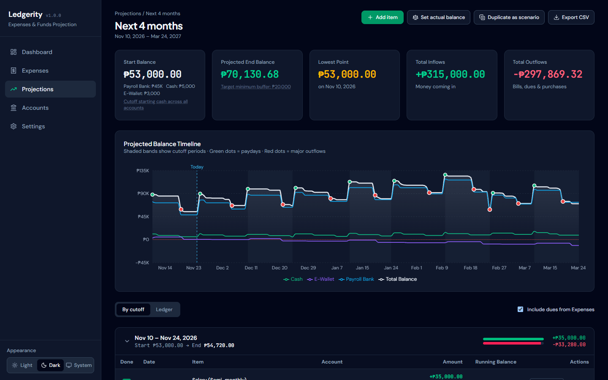

# Ledgerity

**Track what big purchases really cost, and project your balance from payday to payday. Runs on your own computer.**

Ledgerity answers two questions:

1. **What has this big expense really cost me, and am I keeping up with it?** Break a car, a PC or a console into parts and follow each one: installments (with interest, fees and late charges), recurring costs and one-off payments. See the true total, what you've paid so far, what's left, and which dues are coming up or overdue.
2. **How much money will I have, and when?** Start from an amount you enter (one lump sum, or several sources such as bank + cash on hand that add up) and project it forward with recurring income and bills, cutoff by cutoff. Dues from your expenses are included automatically, and you can test "what if" scenarios before you buy.

Ledgerity is not a bank-account or budgeting tracker. It doesn't hold your account balances; you tell it what you're starting with, and it works forward from there.

Everything is stored in a single SQLite file on your machine. There is no sign-up, no cloud, and no tracking.


<table>
  <tr>
    <td></td>
    <td></td>
  </tr>
  <tr>
    <td align="center"><sub>Expense breakdown: parts, interest, payments</sub></td>
    <td align="center"><sub>Funds projection by cutoff period (dark mode)</sub></td>
  </tr>
</table>

<p align="center"></p>

## Features

**Expenses**
- One page per big expense, broken into parts. Each part is **paid in full**, **installment**, **recurring** (insurance, subscriptions), **flexible** (pay any amount, any time) or **planned** (not bought yet).
- **Installment plans** can cover several parts (e.g. GPU + CPU on one card plan), with a down payment, interest (fixed amount, monthly add-on rate, or worked out from the monthly payment), processing fees and late charges. Dues can be monthly, twice a month, every 2 weeks or weekly.
- **Totals that include everything:** paid so far, remaining, true total and cost of financing, plus each part's share of the interest.
- A **due schedule** with overdue alerts, and a **payment log** where each payment is tied to a specific installment, charge or recurring occurrence, so you can check that every due was paid.
- Charts for cost per part, paid vs. remaining, and cumulative payments over time.
- **"Can I afford it?"** for planned parts: test the purchase against a projection, then add it to that projection or to a new scenario.

**Funds projection**
- **Starting balance** from one lump sum or several named sources that add up to the total. You can edit it at any time.
- **Recurring income and bills:** once, daily, weekly (every N weeks), twice a month, monthly, yearly, or custom (pick exact dates on a calendar), with an optional end date or number of times. Weekend dates can stay as they are or move to the previous or next business day.
- View by **cutoff period** (the 10th and 25th by default) or as one **ledger**, with a running balance and a chart marking paydays and big outflows.
- **Plan vs. actual:** tick items as done, enter the real amount, skip or move a single occurrence, or set your actual total balance on a date.
- **Dues from Expenses show up automatically.** Overdue ones are carried to the start of the projection, and you can exclude any of them.
- **Scenarios:** duplicate a projection, change it, and compare up to three side by side.

**Dashboard**
- Balance today according to your main projection (confirmed items only, with unconfirmed ones shown separately), days to the next payday, and the projected end balance.
- Overdue dues and dues in the next 30 days, each with a one-click "Log payment", plus a calendar and recent payments.

**App**
- Light/dark theme and a layout that works on phones.
- Automatic daily backups, one-click restore, JSON export/import and CSV export.
- Optional access from your phone over your home Wi-Fi.

## Getting started

### Requirements

- **[Node.js](https://nodejs.org) 22.13 or newer** (the LTS version is recommended). Ledgerity uses Node's built-in SQLite, so there's nothing else to install.
- Windows, macOS or Linux.

### Install and run

```bash
git clone https://github.com/CJT22/ledgerity.git
cd ledgerity
npm install
npm start
```

Then open **http://localhost:5174**. On first launch you can **start fresh** or **explore with demo data**.

On Windows you can instead double-click **`start-ledgerity.cmd`**. It installs dependencies the first time, starts the app, and opens your browser. To stop Ledgerity, close the terminal window (or press `Ctrl+C`).

### Use it on your phone (optional)

Phone access is **off by default**, because Ledgerity has no login and anyone on the same network could open it.

1. In **Settings → Phone access**, switch it on, then restart Ledgerity.
2. The terminal (and Settings) show an address like `http://192.168.1.20:5174`. Open it on a phone connected to the **same Wi-Fi**.
3. If it doesn't load on Windows, allow **Node.js** through Windows Defender Firewall for **private** networks.

Only turn this on for networks you trust (your home, not a café).

## Your data

| What | Where |
|---|---|
| Database | `data/ledgerity.sqlite` |
| Backups | `data/backups/` |

- **Automatic backups:** a backup is made once a day when the app starts, and the last 14 are kept. A **safety backup** is also taken before any restore, import, demo reset or erase, so those can be undone from **Settings → Backups**.
- **Downloading backups:** you can download any backup as a `.sqlite` file and keep it somewhere safe.
- **Moving to another computer:** copy the whole `data/` folder while Ledgerity is closed.
- **Updating Ledgerity:** `git pull`, then `npm install`, then `npm start`. Your data folder is never touched by updates, and database changes are applied automatically.
- **Privacy:** the `data/` folder is git-ignored, so your finances are never committed.

## Configuration

Set these environment variables before `npm start` if you need them:

| Variable | Default | Purpose |
|---|---|---|
| `LEDGERITY_PORT` | `5174` | Port the app listens on |
| `LEDGERITY_DATA_DIR` | `./data` | Where the database and backups are stored |

Everything else (currency, date format, cutoff days, weekend rule, theme, phone access) is in **Settings**.

## Development

```bash
npm run dev        # API (auto-restarts) + UI with hot reload at http://localhost:5173
npm run dev:lan    # same, but the dev UI is also reachable from other devices
npm run dev:mock   # UI only, with in-browser demo data (no server or database)
npm test           # engine, API, persistence and backup tests (Vitest)
npm run typecheck  # TypeScript, strict mode
npm run build      # production build of the UI into dist/
```

### Tech stack

TypeScript everywhere:
- **Frontend:** React 19, Vite, Tailwind CSS 4, Recharts, React Router.
- **Backend:** Node.js + Express, SQLite via the built-in `node:sqlite` module, and zod for input validation.
- **Tests:** Vitest.

### Project layout (MVC)

```
client/    View: React app
  src/api/        ApiClient interface: httpApi (real server) and mockApi (demo mode)
  src/features/   Dashboard, Expenses, Projections, Settings
shared/    Code used by both the client and the server
  domain/         Pure calculation engine: money, recurrence, cutoffs, installments, projections
  queries.ts      Read models (dashboard, expense detail, comparisons, CSV)
  types/          Domain types
server/    Model + Controller
  src/db/         SQLite connection and schema migrations
  src/models/     Repositories (rows <-> domain types)
  src/services/   Business rules, backups, import/export
  src/controllers/, src/routes/, src/validation/   HTTP layer under /api/v1
tests/     Vitest suites
docs/      Screenshots
```

A request flows **route → controller** (validated with zod) **→ service → models** (SQL). Every read runs the same shared engine that powers demo mode, so the numbers always match.

### Security notes

Ledgerity is designed for a single person on a trusted machine:
- **No login.** Phone access is off by default, and the server only listens on `localhost` unless you turn it on.
- **Cross-site protection.** The server only answers requests addressed to this machine (to block DNS rebinding) and requires a custom header on every write, so other websites can't send requests to your data.
- **Browser hardening.** Standard security headers and a strict Content-Security-Policy are sent, and all assets (including fonts) are bundled locally.
- **Safe imports and exports.** Imported files are validated before anything is replaced, and CSV exports are protected against spreadsheet formula injection.

## License

[MIT](LICENSE) © 2026 CJT22
