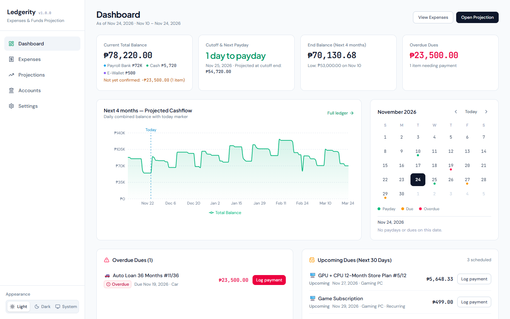
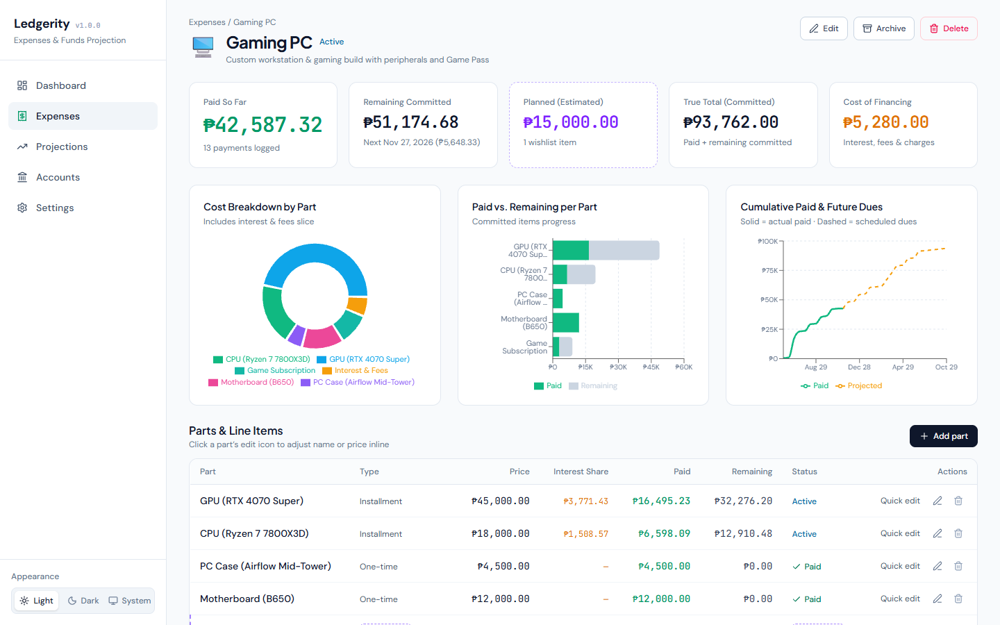
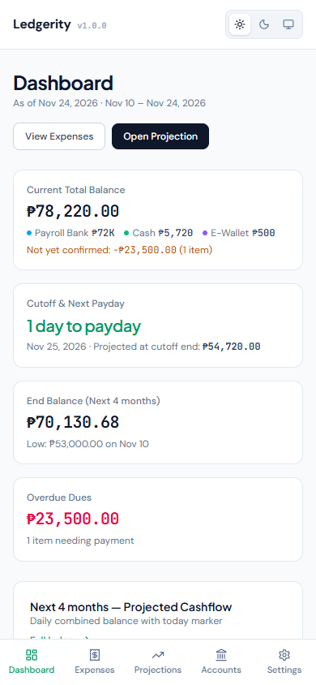

# Ledgerity

**Expenses & funds projection that runs on your own computer.**

Ledgerity answers two questions:

1. **What does this purchase *really* cost?** Break a car, a PC or a console into parts. Track installments (including interest, fees and late charges), recurring fees and payments, and see how much you've paid so far and how much is left.
2. **How much money will I have, and when?** Project your balance from payday to payday with recurring income and bills. Mark items done as they happen, and test "what if" scenarios before you buy.

Everything is stored in a single SQLite file on your machine. There are no accounts, no cloud, and no tracking.



<table>
  <tr>
    <td></td>
    <td></td>
  </tr>
  <tr>
    <td align="center"><sub>Expense breakdown: parts, interest, payments</sub></td>
    <td align="center"><sub>Funds projection by cutoff period (dark mode)</sub></td>
  </tr>
</table>

<p align="center"></p>

## Features

**Expenses**
- One page per expense. Parts can be **paid in full**, **installment**, **recurring** (insurance, subscriptions), **flexible** (pay any amount) or **planned** (wishlist).
- **One installment plan can cover several parts** (e.g. GPU + CPU on one card plan). Down payment, interest, processing fees and late charges are all included in the true total.
- Per-part share of interest, cost of financing, a due schedule with overdue alerts, and a payment log.
- A **"Can I afford it?"** check for planned purchases, run against your projection.

**Funds projection**
- Recurring items: weekly, semi-monthly (10th & 25th by default), monthly, yearly or custom. Weekend paydays move to the next business day.
- View by **cutoff period** or as one **ledger**, with a running balance and a balance chart.
- **Plan vs. actual**: tick items as done, enter the real amount, or set your actual balance.
- **Dues from Expenses show up automatically**, and you can exclude any of them.
- **Starting balance from one lump sum or several sources** (e.g. bank + cash on hand) that add up to the total, editable any time.
- **Scenarios**: duplicate a projection, change it, and compare side by side.

**App**
- Dashboard, light/dark theme, and a layout that works on phones.
- Automatic daily backups, one-click restore, JSON export/import and CSV export.
- Optional access from your phone over your home Wi-Fi.

## Getting started

### Requirements

- **[Node.js](https://nodejs.org) 22.13 or newer** (the LTS version is recommended). Ledgerity uses Node's built-in SQLite, so there's nothing else to install.
- Windows, macOS or Linux.

### Install and run

```bash
git clone https://github.com/CJT22/ledgerity.git
cd ledgerity
npm install
npm start
```

Then open **http://localhost:5174**. On first launch you can **start fresh** or **explore with demo data**.

On Windows you can instead double-click **`start-ledgerity.cmd`**. It installs dependencies the first time, starts the app, and opens your browser. To stop Ledgerity, close the terminal window (or press `Ctrl+C`).

### Use it on your phone (optional)

Phone access is **off by default**, because Ledgerity has no login and anyone on the same network could open it.

1. In **Settings → Phone access**, switch it on, then restart Ledgerity.
2. The terminal (and Settings) show an address like `http://192.168.1.20:5174`. Open it on a phone connected to the **same Wi-Fi**.
3. If it doesn't load on Windows, allow **Node.js** through Windows Defender Firewall for **private** networks.

Only turn this on for networks you trust (your home, not a café).

## Your data

| What | Where |
|---|---|
| Database | `data/ledgerity.sqlite` |
| Backups | `data/backups/` |

- **Automatic backups:** a backup is made once a day when the app starts, and the last 14 are kept. A **safety backup** is also taken before any restore, import, demo reset or erase, so those can be undone from **Settings → Backups**.
- **Downloading backups:** you can download any backup as a `.sqlite` file and keep it somewhere safe.
- **Moving to another computer:** copy the whole `data/` folder while Ledgerity is closed.
- **Updating Ledgerity:** `git pull`, then `npm install`, then `npm start`. Your data folder is never touched by updates, and database changes are applied automatically.
- **Privacy:** the `data/` folder is git-ignored, so your finances are never committed.

## Configuration

Set these environment variables before `npm start` if you need them:

| Variable | Default | Purpose |
|---|---|---|
| `LEDGERITY_PORT` | `5174` | Port the app listens on |
| `LEDGERITY_DATA_DIR` | `./data` | Where the database and backups are stored |

Everything else (currency, date format, cutoff days, weekend rule, theme, phone access) is in **Settings**.

## Development

```bash
npm run dev        # API (auto-restarts) + UI with hot reload at http://localhost:5173
npm run dev:lan    # same, but the dev UI is also reachable from other devices
npm run dev:mock   # UI only, with in-browser demo data (no server or database)
npm test           # engine, API, persistence and backup tests (Vitest)
npm run typecheck  # TypeScript, strict mode
npm run build      # production build of the UI into dist/
```

### Tech stack

TypeScript everywhere:
- **Frontend:** React 19, Vite, Tailwind CSS 4, Recharts, React Router.
- **Backend:** Node.js + Express, SQLite via the built-in `node:sqlite` module, and zod for input validation.
- **Tests:** Vitest.

### Project layout (MVC)

```
client/    View: React app
  src/api/        ApiClient interface: httpApi (real server) and mockApi (demo mode)
  src/features/   Dashboard, Expenses, Projections, Settings
shared/    Code used by both the client and the server
  domain/         Pure calculation engine: money, recurrence, cutoffs, installments, projections
  queries.ts      Read models (dashboard, expense detail, comparisons, CSV)
  types/          Domain types
server/    Model + Controller
  src/db/         SQLite connection and schema migrations
  src/models/     Repositories (rows <-> domain types)
  src/services/   Business rules, backups, import/export
  src/controllers/, src/routes/, src/validation/   HTTP layer under /api/v1
tests/     Vitest suites
docs/      Screenshots
```

A request flows **route → controller** (validated with zod) **→ service → models** (SQL). Every read runs the same shared engine that powers demo mode, so the numbers always match.

### Security notes

Ledgerity is designed for a single person on a trusted machine:
- **No login.** Phone access is off by default, and the server only listens on `localhost` unless you turn it on.
- **Cross-site protection.** The server only answers requests addressed to this machine (to block DNS rebinding) and requires a custom header on every write, so other websites can't send requests to your data.
- **Browser hardening.** Standard security headers and a strict Content-Security-Policy are sent, and all assets (including fonts) are bundled locally.
- **Safe imports and exports.** Imported files are validated before anything is replaced, and CSV exports are protected against spreadsheet formula injection.

## License

[MIT](LICENSE) © 2026 CJT22
